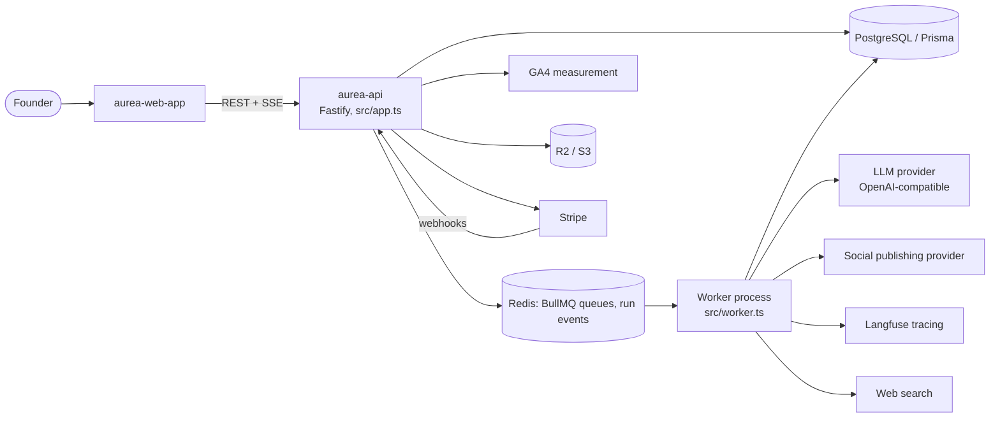
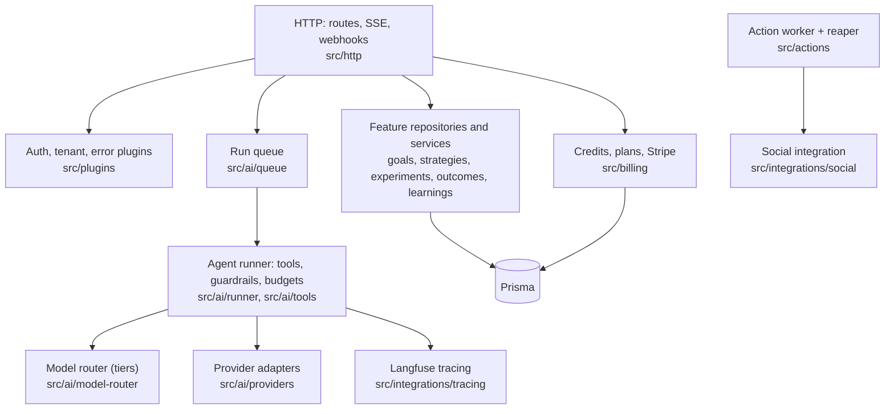
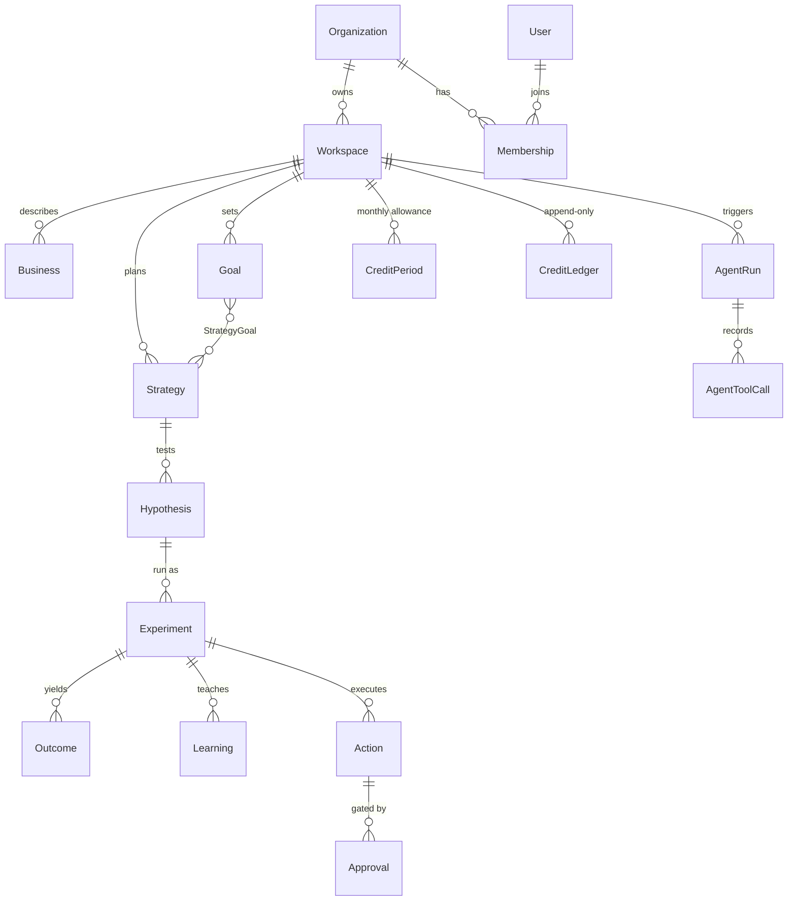

# Aurea API

Backend for Aurea, an "AI growth operating system": a founder states a growth goal and the system drives research, strategy, experiments, execution on social channels, measurement and learning through AI agents over a shared business model.

**Status:** Prototype, not in production. Documentation is mixed Portuguese and English.

## What it does

- Growth domain model: business context, goals, strategies, experiments, actions, analytics, knowledge (`docs/domains/`).
- AI agent runner with proposal/fill flows, per-run budgets and timeouts, and queue-based workers (BullMQ).
- Credit-based AI billing with Stripe subscriptions, credit packs and an append-only ledger (`src/billing/`, `docs/architecture/billing.md`).
- Social publishing through a provider client and a worker with retry/reaper logic (`src/actions/`, `src/integrations/social/`).
- Automatic measurement from GA4 (`src/measurement/`).
- Per-tenant encrypted AI provider keys; Langfuse observability for LLM calls.

## Architecture

System context: the web app talks to this API; a separate worker process runs the AI agents.



Layers inside this repo:



Main flow, one paid AI run (`src/http/api/agent-runs/create-agent-run`, `src/billing/credit.service.ts`, `src/ai/runner/runner.ts`):

```mermaid
sequenceDiagram
  participant W as Web app
  participant A as API
  participant D as PostgreSQL
  participant Q as Redis / BullMQ
  participant R as Worker (runner)
  participant M as LLM provider
  W->>A: create agent run (task type)
  A->>D: authorizeAndCharge: lock credit period, write DEBIT ledger row
  A->>Q: enqueue run
  A-->>W: run id (SSE stream of status events)
  Q->>R: job
  R->>M: model call, tool calls (read-only business tools), submit answer
  R->>R: guardrail validates output; escalate to next tier on failure
  R->>D: persist output, cost, tool calls
  R-->>W: status event via Redis pub/sub and SSE
  Note over R,D: on failure the run is refunded: a REFUND ledger row, unique per run
```

Data model summary (`prisma/schema.prisma`, 30 models; main entities only):



- HTTP layer in `src/http`, domain/services in feature folders, integrations behind small clients in `src/integrations`.
- The AI worker is a separate process (`src/worker.ts`) so an API restart or deploy never kills runs in flight.
- Credits are debited in the same transaction that locks the monthly period row, and the ledger has a unique (run, kind) key so retries cannot double-charge or double-refund (`src/billing/credit.service.ts`).
- Runs have caps on tool iterations and model calls, a per-tier cost record and a tier escalation path (`src/ai/runner/runner.ts`, `src/ai/model-router`).
- Run status changes reach the browser over SSE, fed by Redis pub/sub; a failed publish never fails a run (`src/ai/events/run-events.ts`, `src/http/sse`).
- Environment is validated at boot (`src/config/env.ts`); missing secrets fail fast.
- Architecture docs: `docs/architecture/` (billing, AI, observability, security, data).

## Tech stack

Node 22, TypeScript, Fastify 5, Prisma (PostgreSQL), Redis + BullMQ, Zod, Stripe, S3-compatible storage, Vitest.

## Getting started

Prerequisites: Node 22, pnpm 10, Docker.

```bash
cp .env.example .env      # fill the values; see the table below
pnpm install
pnpm infra:up             # Postgres, Redis, local Langfuse stack
pnpm prisma:generate && pnpm prisma:migrate
pnpm dev
```

All variables are listed in `.env.example`; main groups:

| Variables | Purpose |
|---|---|
| `DATABASE_URL`, `REDIS_URL` | Postgres and Redis |
| `JWT_ACCESS_SECRET`, `JWT_REFRESH_SECRET` | Token signing |
| `AI_PROVIDER_*`, `AI_MODEL_*`, `AI_KEY_ENCRYPTION_KEY` | LLM provider and key encryption |
| `STRIPE_*` | Billing |
| `R2_*` | Object storage |
| `LANGFUSE_*` | LLM tracing; `LANGFUSE_SALT`, `LANGFUSE_ENCRYPTION_KEY`, `LANGFUSE_NEXTAUTH_SECRET` are required by the local compose stack (`openssl rand -hex 32`) |
| `POST_FOR_ME_*`, `TAVILY_API_KEY` | Social publishing, web search |

## Testing

`pnpm test` (unit), `pnpm test:integration` (needs Postgres), `pnpm typecheck`. About 260 test files.

## Project structure

```
src/        http, ai, billing, actions, integrations, measurement, config
prisma/     schema and migrations
docs/       product, domains, architecture, agents
scripts/    dev and asset helpers
```

## Related repositories

- [aurea-web-app](https://github.com/mkwitko/aurea-web-app): React frontend.

## License

All rights reserved. Source available for portfolio review.
